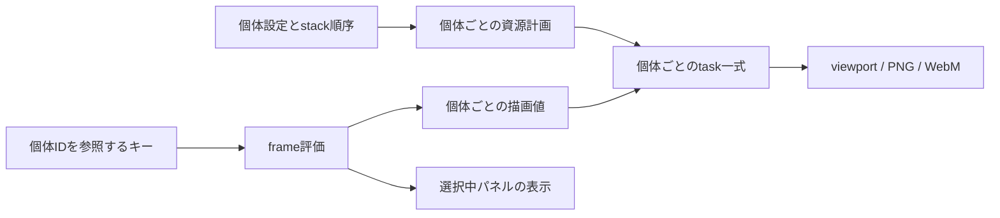

# FrameGraphエフェクトの重ねがけ・タイムライン共同設計

更新日: 2026-10-21
状態: 設計案。runtime・UI・保存形式は未変更。実装対象・標準公開時期・次版収録は未決定。

## 1. 目的と方針

所有者が「FlameGraphタイムラインのせとFlameGraph重ねがけ、これは同時に設計した方がよさそうね」と述べたため、FrameGraphの二つの構想を一つのデータモデルで検討する。所有者の方針は**共同で設計すること**であり、以下のID・操作・保存仕様まで採用されたものではない。

目標は、例えば `Gamma A → Bloom → Gamma B` を作り、AとBの値・キーを独立に編集できること。並べ替え、名称変更、保存再読込、Undo / Redoでもキーの対象を保つ。

種類の定義と、シーンへ追加した個体を分ける。stack、キー、UI選択、Command、描画taskは同じ個体IDを参照する。タイムライン化と重ねがけの設計を揃えたうえで、実装は効果・段階ごとに区切れるようにする。色調補正・線画 / pencil系の追加は別の効果候補として保持する。

## 2. 現行コードで変わる前提

2026-10-21、main `a60e677` と作業中ツリーを静的確認した。既存の未commit描画・PBR調整差分は本設計の変更対象に含めない。

| 箇所 | 現状 | 共同設計で必要な変更 |
| --- | --- | --- |
| [stack helper](../src/shared/frame-graph-post-effect-stack.ts) | entryは `{ id: 種類, enabled }`。正規化と追加で同種を重複排除 | 種類と個体IDを分離し、個体IDの重複だけを拒否する |
| [effect track store](../src/editor/effect-scene-track-store.ts) / [値定義](../src/editor/effect-keyframe-definitions.ts) | `Map<EffectId, Entry>`で1種類1track。payloadも種類だけを持つ | 正規化・補間定義は種類別、track・preview・評価cacheは個体別にする |
| [manager](../src/mmd-manager.ts) | stack、enabled map、パラメーター、キー参照が種類単位 | 個体の状態を持つ小さなstore / serviceへ寄せ、managerは編集・評価・描画の接続を担う |
| [FrameGraph controller](../src/render/frame-graph-post-effects-controller.ts) | `bloomTask`等は各1組。task登録map・接続順も種類がキー | 個体別のtask一式を生成・更新・破棄する。配列の重複を許すだけでは成立しない |
| 同controllerのビネット / エッジブラー | 二つの種類を同じtaskで処理し、接続も一回に集約 | 任意順序・重複に対応するには分離か明示的な複合単位が必要。初期の重複許可対象から外す案 |
| [キー編集](../src/editor/timeline-edit-service.ts) / [キーUI](../src/ui/effect-keyframe-controller.ts) / [MCP schema](../src/automation/keyframe-schema.ts) | `category: effect`の`name`とpayloadの`effectId`を照合 | `name`は個体ID、payloadは個体ID＋種類を持たせ、対象の実在・種類を照合する |
| [serializer](../src/project/project-serializer.ts) / [importer](../src/project/project-importer.ts) / [project型](../src/types.ts) | 静的設定はeffectsの種類別field、stackは配列、キーはversion 1 | 個体設定・順序・キーの参照を同時に復元する入口を作る |

既存キー17種には登録・補間・保存・出力の実装がある。全てを作り直さず、[旧共通基盤](./effect-timeline-common-foundation-design-2026-09-14.md)の編集経路とbase / preview / 評価の分離を流用する。現在は[標準OFFで休止中](./effect-timeline-shelving-2026-09-15.md)であり、本設計の追記では復帰させない。

## 3. 個体・順序・キーのモデル案

以下は概念型。具体名とschema番号は実装時に確定する。種類に応じた設定型を使い、任意propertyへ書き込む汎用setterは作らない。

```ts
type EffectInstanceId = string; // project内で一意。生成後は変更しない。
type EffectInstance<K extends EffectType> = {
    instanceId: EffectInstanceId;
    type: K;
    label?: string;
    staticSettings: EffectSettingsByType[K]; // enabledと固定設定も含む。
};
type EffectInstanceTrack<K extends KeyableEffectType> = {
    instanceId: EffectInstanceId;
    type: K;
    valueVersion: number;
    base: EffectKeyValuesByType[K];
    keys: Array<{ frame: number; value: EffectKeyValuesByType[K] }>;
    preview?: { frame: number; value: EffectKeyValuesByType[K] };
};
// 個体の集合と、適用順を分ける。orderにない個体は休止中として保持できる。
type EffectStackState = { instances: EffectInstanceUnion[]; order: EffectInstanceId[] };
```

- IDは種類名、表示名、配列位置、翻訳名から独立させ、保存・再読込で再生成しない。表示名は `Gamma 1` 等で区別する。新規追加と複製は新しいID、Undoは元のIDを復元する。
- `staticSettings`はキー非評価時の値。trackの`base`は初回track生成時に取り込む、キー評価用の基準値。キー有効時はbase / keys / 同frameのpreviewからキー対応fieldを評価し、固定fieldと合成する。休止中の静的設定と、保管されたキーのbaseは用途を分けて保持する。
- trackなし、またはキー0件なら調整は静的設定へ反映し、存在する空trackのbaseも同期する。キーがあるときの調整は未登録previewに留め、「登録」で対応値全体を一つの差分にする。seek / 再生開始でpreviewを破棄し、PNG / WebMはpreviewを使わない。
- 行は1個体1行。`category: effect, name: instanceId`を内部参照にし、表示名・種類は個体から取得する。行順をstackに合わせる案でも、並べ替えでtrack identityを変えない。休止個体は別に識別表示する。
- 通常のキー適用は個体IDと種類の一致を要求する。クリップボードから別個体へ貼る場合だけ、同種の互換性確認後に対象IDへ明示的に付け替える。他種類への流用を値の形だけで許可しない。
- cacheは個体ID、frame、track revision、静的設定revision、preview採否を含めて管理する。同frameのUndo / import / 固定設定変更でも古い結果を返さない。

## 4. 操作・履歴の案

| 操作 | 状態とキーの扱い |
| --- | --- |
| 追加 | 新しい個体を初期値で作り、orderへ挿入。同じ種類の休止個体のキーを自動で引き継がない |
| 複製 | 新IDへ設定・登録キー・baseをdeep cloneする案。未登録previewは複製しない。画像等のassetは参照できても、変更可能な値・trackは共有しない |
| 並べ替え・名称変更 | orderまたはlabelだけ変更。キー、個体ID、選択対象は維持する |
| 個別ON / OFF | trackがなければstaticSettings、キーがあればpreview / 登録対象のenabledを変更。調整値やキーは消さない |
| stackから外す | orderから除外し、個体とキーは休止状態で残す。休止行からの明示的な復帰で同じIDをorderへ戻す |
| 完全削除 | 個体・order参照・trackを一つのCommandで削除。Undoは同じID・位置・キーを復元し、他個体へ再接続しない |

追加・複製・除外・復帰・完全削除・並べ替えとキー編集は既存Action / Command / diff経路へ接続する。複数値の登録、個体とキーの削除、ID参照の変更を別々の履歴に分けない。再生中の構造編集は初期案では許可せず、値のreadout更新から編集Actionを発火しない。

旧基盤の「種類を再追加すれば休止trackが復帰する」という案は、多重個体では曖昧になる。**新規追加と休止個体の復帰を別操作にする案**として今回整理し、既存の削除済み効果を勝手に復活させない。

## 5. 描画と対応範囲



種類定義に「重複可否」「キー対応field」「対応backend」「値変更に必要な処理」を持たせる。値の準備要件は現在frameだけでなく、base・登録キー・previewからrevision単位で求める。再生中に全キーを毎frame走査しない。

- controllerのtask / wrapper / mutable uniformは個体別に所有する。複数passのBloomやSSAOも個体ごとの一式として管理し、ID入りのtask名で診断可能にする。各個体は直前の色を入力とし、出力を次へ渡す。
- depth / normal等は空間・形式・camera・解像度・更新時点が一致する場合だけ共有する。LUT画像等のimmutable asset共有と、変更可能なwrapper・出力先の共有は分ける。stack順を変えてもgeometry入力の意味は変えない。
- 追加・削除・並べ替え・固定resource変更は既存の[再構築方針](../insights/policies/framegraph-structure-changes-require-rebuild.md)へ集約する。値やenabledのキー評価は、準備済みtaskのuniform更新・disabled pass等で行い、毎frame graphを再接続しない。
- 最初OFFでも後でONになる個体は必要資源を準備する。graph準備完了と画像・shader等のcapture準備完了を分け、再生・各export frameは必要な準備を待つ。準備失敗を効果欠落のまま出力しない。
- 全体OFFは個体・キーを保持して描画資源を解放する。再開・backend切替では保存値から再構築する。Classicで複数個体を一つへ合成・上書きせず、FrameGraphの個体設定を保持し、非対応状態を表示する。Classic固有の既存設定は別に保つ。

最初の実装検証案は**Gamma A → Bloom → Gamma B**。Gammaのtask・値・キーを二個体に分け、間に別効果を置いて適用順も確認する。最初から全種類の重複を許可しない。LUT・深度効果・Luminous等は入力・資源寿命・費用を個別確認し、ビネット / エッジブラーの共有taskやscene側で描画する粒子は別の対応段階にする。

## 6. 保存・移行の案

個体とキーを別々に旧形式へ落とすと、同種が一個へ畳まれる。新形式の正本は個体集合＋orderと、個体IDを参照するtrackにする。従来の種類別fieldはClassic互換等の用途を明示し、FrameGraphの二つ目の正本にしない。

1. 旧projectのstackを従来どおり正規化し、種類ごとに一個体を生成する。旧stackなしの場合だけ既存のcanonical fallbackを使い、明示的な除外やOFFを尊重する。固定設定を含む全fieldを移す。
2. 旧キーversion 1の種類と、生成した個体IDの対応表を作り、projectへ保持する。stack外の既存trackには休止個体を用意する。同種を後から追加しても対応表は書き換えない。
3. キー機能が標準OFFの間は、旧`effectAnimations`を未知field・preview込みでそのまま保管し、評価・正規化しない。再開時に対応表を使い、既知trackだけを個体参照へ移行する。未知version / 種類はopaqueに保管し、別個体へ推測で結び付けない。移行失敗時は元データを残す。
4. 新規の個体track形式は`effectAnimations.version: 2`を案とする。個体IDが不明、同じIDで種類が違う、orderに重複参照がある等の不整合は診断し、黙って別の同種へ付け替えない。
5. 新しい個体モデルを保存するprojectは**top-level version 2**を推奨案とする。現行importerはversion 1だけを受理するため、旧アプリが新形式を部分読込して重ねがけを失うことを避けられる。新readerは旧version 1を読む。schema番号・旧版向け書出しの要否は未決定。

project versionを上げる場合は、型・importer / serializerだけでなく[runtime reload](../src/project/runtime-reload-project-state.ts)、別window / exporter、MCPのproject入出力、codecとfixtureも同じ区切りで追従する。途中段階のデータを公開形式として保存しない。

## 7. 実装段階と確認項目

段階ごとに検証・commitできるようにするが、初期の型・参照・保存設計は二機能を一緒に決める。以下は実装計画の案であり、着手指示や工数見積もりではない。

| 段階 | 到達点 | 最小の確認 |
| --- | --- | --- |
| 1. 共通モデル | 個体、order、種類定義、移行helper、個体参照payloadをpure helperで扱う | 同種二個体、ID安定、未知データ保持、旧stack / 旧キー対応、base / preview、atomic diffのunit |
| 2. 一効果で縦に通す | Gamma二個体をGUI追加・個別調整・キー登録・描画・保存復元へ接続する | Aだけの変更でBが変わらない。並べ替え・Undo / Redo・除外復帰・完全削除復元でキーの対象が変わらない |
| 3. 順序と出力 | Bloomを挟み、構造変更と値更新の境界、backend往復を通す | GUI E2Eで順序差・PNG / WebMの同frame再現、初期OFFからON、非0開始・逆seek、capture準備待ち、validation errorを確認 |
| 4. 段階拡張 | 対応可能な種類をallowlistへ増やす | 種類ごとの個別値・固定asset・資源所有・OFF・出力を確認。休止中の17種を一括復帰した扱いにしない |

実装時はlint・unit・typecheck / critical gateに加え、保存・UI・runtimeを変更する段階でローカルGPU環境のPlaywright Electron E2Eを使う。fixtureは配布可能なものに限定する。可視行だけの描画、revision別cache、選択中パネルだけの更新など、既存timelineの更新単位を維持する。

実装前に残る仕様判断は、最初の対象種類、複製時にキーも含めるか、除外 / 完全削除のUI、タイムライン行順、project version更新の範囲。今回の検証はsource・既存設計との照合と文書のリンク・構造確認のみで、新しい多重描画・移行処理を実行した結果ではない。
