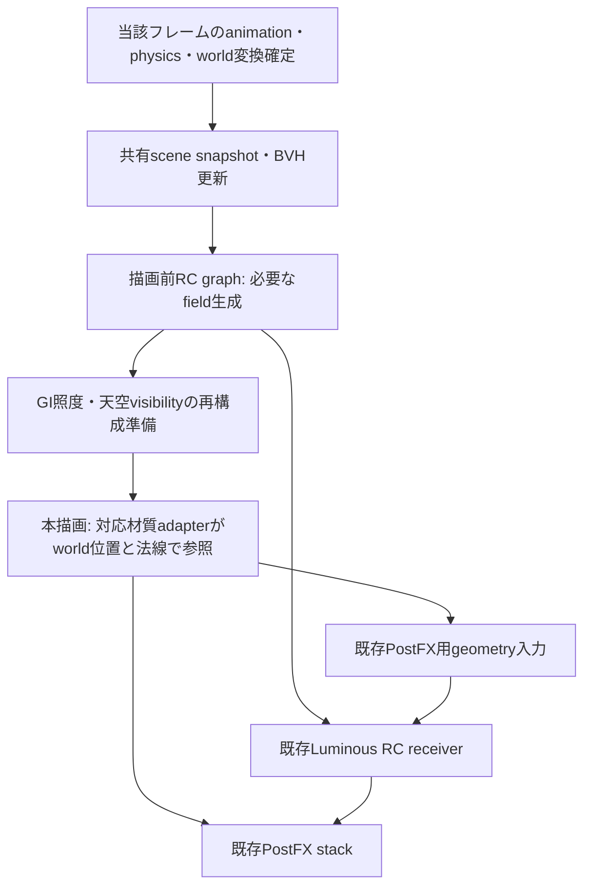

# RC共通基盤・拡散GI・天空遮蔽の実装案

作成日: 2026-10-28。2026-10-30更新。状態: 段階A/Bと段階Cの開発用検証を実装・確認済み。Cの再構成比較で終点8をlab既定にした。[RC天空遮蔽](./rc-sky-occlusion-implementation-2026-10-29.md)は最初の1効果として通常材質・設定/保存・Undo/キー・backend・骨/モーフ・PNG/WebMまで実装し、負荷軽減後のGPU 11件をfixtureで確認した。同日、所有者から実機の見た目・軽さのOKと「これでいったんいい」との判断を得て、今回の天空遮蔽を一区切りとする。密なモデル・低性能PC・physicsなどの未確認条件は残存制約として保留する。GIは未実装の設計案で、今回は着手しない。

所有者の「おすすめ設定で実装案を書いて、ドキュメントとして置く」という依頼に基づく。[応用と共有境界の調査](./radiance-cascades-shared-effects-design-2026-10-28.md)を実装単位へ具体化する。その後の実装依頼により、[段階Aのscene/BVH共有](./radiance-cascades-shared-scene-implementation-2026-10-28.md)へ着手した。以下は当初の推奨案を含む設計記録であり、現在の天空遮蔽の構成・初期値・UI・検証結果は[実装メモ](./rc-sky-occlusion-implementation-2026-10-29.md)を正本とする。未実装GIの数値・内部名・UI配置や次版収録は決定していない。

続いて[段階Bの同条件の光場計算共有](./radiance-cascades-shared-field-implementation-2026-10-28.md)を実装。range変更時のrebuildを増やさないため固定の予備slotは残し、同条件のcascade計算とfield参照を共有する。fieldメモリ削減は今回の完了範囲に含めない。

[段階Cの描画前producer・天空visibility表示](./radiance-cascades-sky-visibility-validation-2026-10-29.md)を初回実装し、[近距離分割・終点参照の比較](./radiance-cascades-sky-reconstruction-2026-10-29.md)で全面屋根Y=2の漏れを0.125から0へ改善した。Y=4の残差と少数方向の誤差、有限屋根の高密度参照への誤差悪化は残る。[段階Dの材質adapter案](./radiance-cascades-material-adapter-plan-2026-10-29.md)では固定床の結果を通常材質へ投影せず、任意位置・法線queryを先に検証する。

2026-10-29、所有者は[アプリから確認できる1エフェクト単位で完成させ、目視しやすく区切る方針](../insights/decisions/complete-rc-effects-one-at-a-time-for-visual-review.md)を明示した。これを受けたagentの作業計画は、まずRC天空遮蔽を材質・UI・保存・出力まで接続して目視比較できる状態にし、その後の候補としてGIを同じ単位で進めるものだった。天空先という具体的な順序と以下の完了条件はagent計画として区別する。2026-10-30には天空遮蔽の負荷軽減と実機の見た目・軽さが所有者に確認され、今回の効果の区切りを完了した。GIは次候補に留める。

## 1. 推奨構成と最初の範囲

**ルミナスRC、RC GI、RC 天空遮蔽は独立した効果として扱い、形状・BVH・同条件の光場を共通基盤で管理する。** 一つのRCエフェクトのON/OFFへ全機能を従属させない。

| 項目 | 最初の役割 | 操作と適用位置 |
| --- | --- | --- |
| 通常ルミナス `luminous` | 発光の芯・にじみ・glare | 現在のPostFX個体・並び順を維持 |
| ルミナスRC `luminousRadiance` | 発光面から表面へ届く光 | 現在のPostFX個体・複数配置・合成位置を維持 |
| RC GI `rcDiffuseGi`（仮称） | メイン方向光を受けた面からの1反射 | 独立したシーン照明設定。初回は1シーン1個、適用順固定 |
| RC 天空遮蔽 `rcSkyOcclusion` | 空への可視性で通常MMDの影側残光を抑える | 独立したシーン照明設定。1シーン1個、適用順固定 |
| RC共通設定 | 新しいGI/天空遮蔽の計算範囲・品質 | 設定の共有。単独のエフェクトや追加のmaster ON/OFFにはしない |

当初の固定「照明」欄案から、最初の天空遮蔽は通常の **設定 → 実験設定…** に独立項目を置く実装へ具体化した。天空遮蔽の公開を未完成のGIとまとめて待たせず、GIの操作項目だけを先に出さない。既存PostFX一覧は従来どおり並べ替え、天空遮蔽には実行順が変わるドラッグハンドルを付けない。既存の`frameGraphPostStack`へ新IDを足して順番だけ無視する実装にはしない。

初回対応はFrame Graph / WebGPUと通常MMDのopaque材質。通常Standard材質へのadapterは今回追加しない。PBR、独自WGSL、Skin等の別lighting経路、透明・alpha-test材質の正確な遮蔽、複数反射、天空の反射、発光の追加反射、粗い鏡面反射、霧は後続の範囲とする。対象外材質は元の表示を維持し、全材質へ適用済みと表示しない。

機能完成前は開発用の有効化条件内に置き、通常の操作項目として追加する時点で保存・Undo・キー・backend往復・出力まで揃える。既存ルミナスRCを隠したり、通常ルミナスとの分離を戻したりしない。

## 2. 推奨初期値

新しい照明機能の既定はOFF。利用者が追加/有効化したときの開始値を以下にする。性能・ルックの検証前なので、値の正本は初期実装時のnormalize helperへ集約し、fixtureと実機比較後に見直す。

| 設定 | 推奨開始値 | 意味・互換 |
| --- | --- | --- |
| RC GI 有効 | 未設定ではOFF、明示操作でON | 旧projectの見た目を変えない |
| RC GI 強度 | 実値0.5、範囲0〜2 | 反射光の見た目の倍率。光場へ焼き込まず材質への適用側で使う |
| GI反射回数・入力 | 1回・メイン方向光のみ | 初回は固定。天空・Luminousの追加反射を自動で混ぜない |
| RC 天空遮蔽 有効 | 未設定ではOFF、明示操作でON | GIやルミナスRCから独立 |
| 天空遮蔽 強度 | 実値0.75、範囲0〜1 | 空の可視性による環境寄与の抑制量 |
| 最低残光 | 実値0.2、範囲0〜1 | 通常MMDの影側を完全な黒へ落としにくくする演出値。発光・GIを底上げする値ではない |
| 品質 | 標準の1種類から開始 | 低/高プリセットや自動品質変更は比較後に追加 |
| 更新 | 入力が変わった当該フレームに更新 | 静止時は再利用。更新間引き・時間平均・前フレームへの退避は初期OFF |
| 既存ルミナスRC | 現在の保存値を保持 | 新規個体は現行の強度1・範囲12・柔らかさ0。距離連動はOFF固定 |

スライダーは既存の操作値0〜100規約へ変換し、保存値は実値とする。上表のGI強度0.5は線形0〜2の操作値25、天空遮蔽0.75は75、最低残光0.2は20。表示値と保存値を混同しない。

標準品質の出発点は現行RCの4段、probe grid `16³ / 8³ / 4³ / 2³`、方向数`32 / 128 / 512 / 2048`。既存Luminous receiverは半解像度・長辺640を維持する。新しい材質照明は世界座標のfieldを読むので、screen receiver解像度と材質の最終描画解像度を同じ設定として扱わない。照度atlasの具体的な解像度・近距離補正は後述の検証段階で決める。

最初の天空遮蔽の比較では、天空遮蔽を上表でONにし、未実装のGIには依存しない。GIの完成後に両効果の併用比較を追加し、その新規比較用プリセットではSSGI/RSM GIをOFFから評価する。既存projectで新効果のチェックを入れただけでは他の効果を勝手にOFFにしない。将来プリセット操作を提供する場合は、変更内容を表示して一つのUndo可能なCommandとして適用する。

ルミナスRCの柔らかさ20〜30は[所有者の特定シーンで良好だった調整例](./luminous-radiance-softness-2026-10-26.md)。一律の新規既定や旧保存値の置換にはせず、必要なときの調整目安とする。

## 3. 計算範囲と遮蔽物

新しいGI/天空遮蔽のvolumeは発光面に依存させない。天空遮蔽の初期実装は`volume: null`を自動範囲として保存し、現在読み込まれている対象通常MMDのboundsから余白付きのworld-space boxをruntime内で解決する。描画準備で保存値を変更せず、明示的な再計算・数値編集だけを固定範囲として保存する。skydome、背景、gizmo、helperは対象から除く。カメラ移動や毎フレームのposeに追従して自動伸縮させない。

範囲は「現在のシーンから範囲を再計算」と数値編集で変更できる。初期計算は最大軸の長さへ両端10%ずつの余白を付ける案とし、空シーンでは未設定のまま準備待ちにする。巨大ステージを自動で細かく照らせるとは扱わず、セル幅を診断表示し、受け取り範囲の調整を可能にする。数値・空bounds・非有限値の正規化をpure helperで扱う。

**光場を配置する範囲と、遮蔽物の収集範囲を分ける。** BVHは画面外・volume外を含むシーンの対象opaque形状を保持する。新しい照明のalpha-test/透過は未対応と明示し、既存Luminousの材質選択規則を共有化のついでに変更しない。

天空visibilityは、最後の区間が有限距離でmissしただけで1にしない。対象scene boundsの外まで遮蔽物がないことを調べる。上限超過・不完全な入力は「空が見える」と置換せず、そのconsumerを中立化して理由を診断する。範囲外の受け手はGI寄与0・天空補正なしとする。範囲境界の2セルを目安とする連続的な遷移は後続課題で、今回の材質接続には未実装。既存Luminousのvolume/range計算はそのまま保持する。

## 4. FrameGraphの実行段階

[現在のcontroller](../src/render/frame-graph-post-effects-controller.ts)はeditorで描画済みの`sceneColor`をimportし、display/gamma空間として扱うPostFX graphである。先頭へGI taskを追加するだけでは、本描画の材質へ照明を入力できない。

推奨案は、世界座標のproducerだけを扱う**描画前のRC用FrameGraph**を追加し、既存の本描画とPostFX graphをその後へ接続する構成。editor本描画全体をFrameGraphへ移行する作業には広げない。



接続契約は次のとおり。

- 描画前graphの入力はworld geometry・material source・lightだけとし、本描画のdepth/normal/colorを要求しない。同じframeの描画結果を、その描画が読む入力にして循環させない。
- frame準備はeditorとexporterの共通入口から呼ぶ。pose/physics確定後・最初のmaterial draw前であることを検証し、単に任意の`onBeforeRender`へ登録して順序を推測しない。observer/APIの具体的接続点は段階Cで現行Babylon/babylon-mmdの実行順と照合する。
- GPUのpass/queue順序でproducer完了後にconsumerが読む。毎フレームのCPU readbackやGPU完了待ちは入れない。出力準備完了の契約は、必要textureと当該frameのfield世代を含める。
- graph間で共有する実texture/bufferはサービスが所有し、各graphでは必要なhandleへimportする。単一graph専用のtransient handleを別graphへ渡さない。前段のstorage書込みと後段のsamplingを別passへ分ける。
- 初期の共有化は既存PostFX内で完了させ、描画前への移動は新しい独立検証単位とする。移動後もLuminousのreceiver・非線形合成・各個体の位置は変更しない。
- 前frameのfieldを仮に使って循環や準備不足を隠さない。直接seek・一枚PNG・動画の最初のframeも、同じ入力から結果を作る。

## 5. 光の寄与と通常MMDへの接続

初回は光場を`emission`、`directBounce`、`skyVisibility`という異なる意味のresourceとして管理する。異なる成分を混ぜたtextureから後で独立強度を復元しようとしない。

| 成分 | 入力・意味 | 適用先 |
| --- | --- | --- |
| emission | 現在のLuminous材質の発光色。2Dとの色合わせを維持 | 既存Luminous RCの合成のみ |
| directBounce | 非発光の反射成分も含むsurfaceの`albedo / π × メイン方向光の直接照度`。light方向の遮蔽を含む | RC GIの拡散寄与 |
| skyVisibility | 空方向への通過率。既存の発光RGBとは別 | 対応する環境光・通常MMDの影側残光の抑制 |

GIのrayが当たった面ではworld法線、UV付き反射率、直接光を評価する。初期版はhitで直接評価する参照実装から始め、費用を測ってsurface sourceのcache/事前集計を比較する。画面内G-bufferだけを反射入力にすると画面外の面を失うため、それを唯一の入力にしない。完成色、Bloom、前回のGI、既存Luminous RCの合成結果をsourceへ戻さない。

この分担では、発光面から直接届く寄与はLuminous RC、方向光を面で1回反射した寄与はRC GIが担当する。同じ発光面でも方向光を反射する成分は別であり、emissionをGIのsourceへ再加算しない。天空による1反射や発光の追加反射は別成分として後続追加する。

天空遮蔽は背景の空画像を暗くするエフェクトではない。[通常MMDのToon patch](../src/mmd-manager.ts)は影側にも`info.diffuse * toonShadowBand`相当を残し、[半球光](../src/scene/light-shadow-controller.ts)の初期強度は0である。半球光だけへ係数を掛けても通常MMDの屋内が暗くなるとは限らない。

通常MMD用adapterで、既存の直接明部と影側残光を分け、環境寄与/影側残光だけへ次の係数を適用する。`V`は法線と天空入力の重みを考慮した0〜1の可視性、`s`は強度、`m`は最低残光。

```text
skyFactor = 1 - s * (1 - (m + (1 - m) * V))
```

開始値では屋外`V=1`で1、完全遮蔽`V=0`で0.4になる。これはToonの明るさを残す演出上の設定で、物理的な残留光を証明する値ではない。直接明部、発光、specular、独立のGIへこの係数を重ねない。係数1・GI0のときに従来のToon出力へ戻ることを先に確認し、分離のためのshader追加は局所adapterへ閉じ込める。

材質adapterはworld位置・法線から再構成した照度/visibilityを読む。粗いprobeの単純補間だけで薄壁を解決済みにしない。近距離の方向別遮蔽、面の識別、光漏れの対策を検証する。**probe側の照度事前集計は新経路の比較候補だが、旧Luminous receiverの置換と同時に行わない。** 材質側の参照と近距離補正が局所的に実現できない場合、段階Dは検証画面に留め、その制約を記録する。

CSM、ShadowGeneratorの選択、cascade数、全体bias、影距離は本案の変更対象にしない。GIの直接光visibilityをBVHで求める場合は既存raster影との一致/差を比較し、その差を既存のシーン全体の影設定変更で隠さない。

## 6. 共通基盤の責務と共有条件

新規モジュール名は仮称。manager/controllerへ全処理を追記せず、最小の責務ごとに分ける。

| モジュール案 | 責務 |
| --- | --- |
| `radiance-scene-service.ts` | scene/engineごとのsnapshot、pose、material source、BVH、変更領域・revision。既存mesh/triangle BVHとpose cacheを再利用 |
| `radiance-resource-plan.ts` | consumer要求から共有group・必要成分・依存・予算を作るpure helper |
| `radiance-field-pool.ts` | group別field/epoch/履歴の所有、更新、参照、解放。無効な古いhandleを公開しない |
| `frame-graph-radiance-lighting.ts` | 描画前のproducer task構築と依存固定 |
| `mmd-radiance-lighting-adapter.ts` | 通常MMDへのGI・天空遮蔽の適用境界。OFF時の中立化 |
| `radiance-lighting-settings.ts` | 新設定のnormalize、UI値変換との契約、保存version、キー評価入力 |

`RadiancePlan`は既存resource planから参照する専用のsubplanにする。現在の`FrameGraphSharedResourceKey`は全解像度の画像中心なので、bufferやworld fieldを同じ`resolution: full`として無理に登録しない。consumersは効果種別だけでなく個体IDを持つ。

共有groupの構造keyはscene/engine、遮蔽物選択規則、source成分、volume、probe/方向解像度、精度、輸送方式、反射段階。内容のrevisionは別に保持し、毎frame新しいpool entryを増やさない。形状・反射率・emission/texture・light・visibilityの変更を必要なgroupだけへ伝播させる。

既存Luminousのrangeが違えばfieldは別でもscene/BVHは共有できる。強度と柔らかさはfieldのkeyへ入れない。一方、現行receiverは強度を出力へ焼き込むため、receiverを共有する場合は強度も含む入力一致が必要。初回はfieldまでの共有に絞り、half丸めを変える強度の移動や非線形合成の統合は行わない。

emission fieldのRGBだけを比べる現行epochを、天空visibilityの更新判定へ使い回さない。直接光sourceでは「受け手とhit面の間」だけでなく「hit面とライトの間」の遮蔽物移動も反射光を変える。最初は形状が変われば影響するGI/visibility field全体を更新し、局所無効化は取りこぼしのない参照実装と比較してから追加する。

scene/engineごとの所有者は一つにし、共有snapshotを同じframeで何度も更新しない。consumerはleaseを持ち、個体削除で共有bufferを破棄しない。全consumerが休止ならdispatchを止め、キーで再有効化するための確保済み資源は保つ。FrameGraph全体OFF・backend離脱・scene破棄では安全な順に解放する。材質側のbindingも中立textureへ戻してから解放する。

## 7. 状態・保存・backend・既存GI

最初の天空遮蔽は`lighting.rcSkyOcclusion`へ`enabled / strength / minimum / volume`を保存する。キーは`keyframes.effectAnimations`の専用singletonを使う。当初の`effects.rcLighting`統合案は今回採用せず、GIの保存構造は後続の実装時に決める。既存`luminousRadiance`の個体ID・固定値・enabledキー・並び順・削除状態は移動しない。新しい共通profileを旧Luminous個体へ暗黙適用しない。

- 新設定がない旧projectは新機能OFF。既存Luminousの現在の保存値と復元規則を維持する。非有限値・未知enumをnormalizeし、normalizeを繰り返しても値や個体が増えない。
- OFFは値を保持し、削除/無効化をload時に復活させない。texture、BVH、cache key、GPU handleは保存しない。
- 新しいGI/天空遮蔽もAction→Command→差分→Undo/Redoを使う。enabledはstep、強度は実値の線形補間を初回のキー対象とし、共通範囲・品質・最低残光は固定値にする。scene照明trackとして扱い、既存PostFX個体の順序とは分離する。
- Classicでは設定とキーを保持して新RC照明の実行を休止する。Frame Graphへ戻したときに一度だけ再構築し、材質adapterや旧PostProcessを二重に残さない。
- 確保済み依存内のON/OFF・強度キーはrebuildしない。追加/削除、品質・format・接続変更はrebuildする。範囲変更は形状の確保が同じならfieldを無効化するだけにし、再構築の要否をpure planで判定する。
- 順序・依存・最終表示は[FrameGraphの現行仕様](./framegraph-post-stack-current-spec-2026-07-01.md)と[構造変更の契約](../insights/policies/framegraph-structure-changes-require-rebuild.md)へ合わせ、新しい固定照明欄との境界を実装時に現行仕様へ追記する。

SSGIは直前のsceneColorを入力とするためRCの寄与も再度集め得る。RSM GIは[独立controller](../src/render/global-illumination-controller.ts)と材質pluginを使い、PostFX列から外すだけでは停止しない。比較用プリセット以外では既存設定を自動変更せず、併用中の寄与重複を詳細欄へ短く表示する。RSMをOFFにする操作では既存のmanager/RSM両方の停止契約を使う。SSAOは近接陰影の補助として併用比較し、天空遮蔽と同じ全体暗化を二重に掛けない。

## 8. 効果単位の実装順と完了条件

タスクの状態は[基本チェックリスト](./mmd-basic-task-checklist.md)へ集約する。A〜Fは元の作業分類として残すが、共通基盤の後にD・Eの内部計算を先行し、最後にFでまとめてUI・保存・出力を仕上げる順序は使わない。以下は所有者の「1エフェクト単位で目視できる状態へ」という方針に沿うagent計画で、実施済みの一覧ではない。

| 段階 | 作業単位 | 次へ進む条件 |
| --- | --- | --- |
| A | 既存RCのscene/BVHを共通所有へ分離 | RC 1個/2個でprepare/refit/uploadが重複せず、既存PNG・設定・破棄が一致 |
| B | 同条件のemission field共有 | 同じrangeならfield更新はgroupごとに1回。異なるrange、強度、柔らかさ、合成順でも旧結果と一致 |
| C | 描画前producerと天空visibilityの検証画面 | pose更新後・本描画前の同frame依存、発光なし、画面外屋根、有限miss、seek/直接PNGを確認 |
| D | 任意位置・法線query、通常MMDの残光adapterと天空遮蔽 | queryの漏れ・負荷を先に確認し、OFF/強度0で旧画像へ戻る。屋外→軒下→屋内、Toon境界、発光維持、薄壁を比較 |
| E | 静的ステージの方向光1反射GI | 色壁・床の反射、黒い材質、画面外surface、遮蔽、Luminousとの寄与分離、直射変化を確認 |
| F | 各効果のPMX変形、正式な操作導線と保存/出力 | 対象効果ごとに骨・morph・physicsの当該pose、キー、Undo、project、backend、PNG/WebMまで一式で一致。全効果の最後へ一括先送りしない |

具体的な実行順は次のとおり。

2026-10-29の天空遮蔽提示後、所有者から実使用の負荷NGと次回の負荷軽減の意向が示された。2026-10-30には、[低〜中性能PCのアマチュアMMD利用者向けの軽量でシンプルな既定動作](./mmd-project-positioning-note.md#想定利用者と既定動作2026-10-30-所有者指定)を設計条件として、負荷軽減への着手が指定された。agentは5方向集計＋probe近傍2三角形の接続遮蔽を実装し、固定fixtureの性能比較と最終GPU 11件を確認した。同日、所有者はスクリーンショット2枚を添えて「いいルックにいい軽さです。天空遮蔽はこれでいったんいいでしょう」と判断したため、今回の天空遮蔽は一区切りとする。密なモデル・低〜中性能PC・physicsの未確認条件は完了ブロッカーにせず、問題の再現や対応範囲の拡張時に再検証する。性能の数値目標は未設定で、実機OKを全条件の保証には広げない（[実装・実機確認と残存制約](./rc-sky-occlusion-implementation-2026-10-29.md)）。

1. **共通基盤・診断（A/B/C）**: 完了した共有化と検証経路を土台にし、天空遮蔽に必要な修正へ範囲を絞る。
2. **RC天空遮蔽を1効果として仕上げる（D＋天空遮蔽に必要なF、今回完了）**: 任意位置・法線query、通常MMD材質への適用、アプリの操作導線、初期値・保存/読込、Undo/キー、backend切替、同frameの骨/モーフ更新、PNG/WebMを通した。OFF/強度0の旧表示復帰、直射・発光の維持、屋外・庇下の比較と残る制約を実装メモに記録した。
3. **天空遮蔽をアプリで目視比較する区切り（所有者確認済み）**: アプリ内の入口とON/OFFの比較手順、対象材質・範囲、確認済み項目と残る制約を提示し、2026-10-30に所有者が実機の見た目・軽さを確認して一区切りとした。
4. **次候補: RC GIを1効果として仕上げる（E＋GIに必要なF、未着手）**: 方向光1反射GIを材質・UI・保存・出力まで同様に通す案。着手時はLuminousとの寄与分離、色壁・床・画面外surface、直射変更、天空遮蔽との併用を確認し、再びアプリで目視できる区切りを作る。今回の天空遮蔽の完了に続けて自動的に着手しない。

効果を実装する際は、材質・render順序に未解決の制約があれば対象範囲と完了条件を明示し、内部計算だけを複数効果へ広げない。今回の天空遮蔽では既知の近似誤差と未確認条件を残存制約として保留し、所有者が確認した区切りを完了とする。採用済みのprobe照度事前集計を超える変更、疎なprobe、GPU変形/refit、反射・媒質は、必要が生じた時の別の比較単位とする。

## 9. 検証計画と未確定点

pure helperの最小テストは共有group生成、consumer増減、normalization、旧設定の維持、キー評価、dirty revision、資源解放の所有関係。共有化のためだけに巨大controllerをmockしない。

ローカルElectron/WebGPUのfixtureでは、同条件/異なるrangeのRC複数配置、強度・柔らかさ・合成順、全OFF/削除/再追加、初期OFFキー、Undo/Redo、保存読込、Classic往復、出力解像度変更を確認する。新照明は箱・庇・薄壁・色壁と、配布可能な骨/morph fixtureで調べる。GUI導線はGUI操作で最終状態まで検証し、GPU E2Eはsandbox外のローカル権限で実行する。

静止、camera移動、骨/morph変形、発光だけの変更、直接光だけの変更を分け、CPU prepare/refit/upload、GPU field/再構成/合成、メモリ、全体frame timeの中央値/p95を比較する。GPU timestampを取れない場合はN/Aを残し、submission完了までのwall timeと混ぜない。天空遮蔽の2026-10-30の計測条件と結果は[実装メモ](./rc-sky-occlusion-implementation-2026-10-29.md#負荷軽減の性能比較再検証2026-10-30)に記録し、未計測のPC・モデル規模に一般化した高速化率や目標値は置かない。

同じ確定pose・light・設定について、直接seek後と再生後、previewとPNG/WebMの照明を比較する。physics自体の再生履歴差はRC cacheの問題と分ける。共有化A/Bは元画像との一致、新照明は固定fixtureと低解像度の直接ray評価を参照に、暗部・光漏れ・動いた直後の残光を確認する。

コード変更時は[mmd-test](../.agents/skills/mmd-test/SKILL.md)に従い、lint、関連unit、typecheck/criticalと既存baseline比較を実施。render順序・初期化変更ではsmokeを追加し、UI導線・保存・出力変更では対象E2Eを追加する。

着手前に詰める技術的な点は、描画前の安全な接続点、通常MMDの残光分離の同値性、材質で読むfield形式と近距離visibility、広いstageに対するvolume密度・予算である。段階C/Dの小型fixtureで決め、未検証のまま万能GIとして通常UIへ公開しない。

## 10. 根拠と今回の検証

現行の参照点:

- [RC task生成](../src/render/frame-graph-luminous-radiance.ts)、[scene/BVH入力](../src/render/luminous-radiance-scene.ts)、[既存設定の正規化](../src/render/luminous-radiance-settings.ts)、[cascade layout](../src/render/radiance-cascade-lab-model.ts)。
- [resource plan](../src/render/frame-graph-resource-plan.ts)、[通常Luminousとの分離](./framegraph-luminous-rc-separation-2026-10-25.md)、[光・影のToon分離](./light-shadow-implementation.md)、[RSM GIの現行制約](./babylon-rsm-gi-notes.md)。
- [共有資源の意味](../insights/policies/preserve-render-resource-semantics-before-sharing.md)、[設定のライフサイクル](../insights/policies/ui-state-must-complete-its-lifecycle.md)。

外部方式の根拠は本会話で一次資料を照合した[応用調査](./radiance-cascades-applications-webgpu-research-2026-10-25.md)と[共有境界の調査](./radiance-cascades-shared-effects-design-2026-10-28.md)を参照する。Split RCの照度事前積分をそのまま採用する決定や、新しい外部APIが使えるという確認は今回行っていない。

設計書作成時はローカルコード・既存文書の照合、設計レビュー、文書リンク・差分確認のみ。描画コード、設定の既定値、GPU資源、依存packageは変更していない。その後の実装内容と検証結果は、[段階A](./radiance-cascades-shared-scene-implementation-2026-10-28.md)、[段階B](./radiance-cascades-shared-field-implementation-2026-10-28.md)、[段階Cの初回検証](./radiance-cascades-sky-visibility-validation-2026-10-29.md)、[再構成の品質・費用比較](./radiance-cascades-sky-reconstruction-2026-10-29.md)のメモへ分離して記録する。[段階Dの材質adapter調査](./radiance-cascades-material-adapter-plan-2026-10-29.md)を経た[RC天空遮蔽実装・検証記録](./rc-sky-occlusion-implementation-2026-10-29.md)には、unit 212ファイル・1,316件、lint、critical型検査、WebGPU起動と対象GPU 5件の結果を記録した。通常typecheckは既知547件・追加0件。WebMの暗化差はdirty fieldの提出境界で解消を確認し、絶対MAE条件でも再検証した。ユーザー実モデルの目視と大規模PMX性能は別途確認する。
