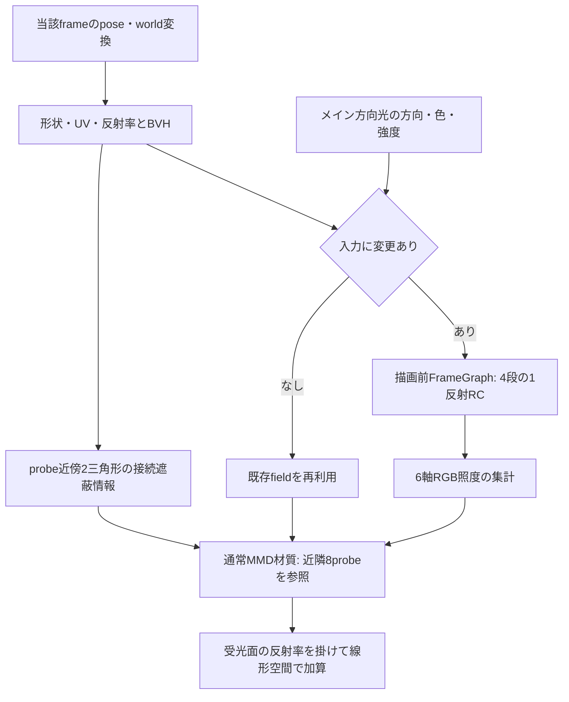

# RC GI: 方向光1反射の通常MMD材質への実装

作成日: 2026-10-30。状態: **初版を設定・保存・キー・PNG/WebMまで実装し、fixtureで検証済み。所有者の実モデルでの目視確認はこれから**。所有者の「次はGIの方を進めて」という依頼に基づき、[天空遮蔽](./rc-sky-occlusion-implementation-2026-10-29.md)に続く1エフェクトとして実装した。[実装計画](./radiance-cascades-lighting-implementation-plan-2026-10-28.md)のE＋GIに必要なFに相当する。

## 操作と保存

入口は **設定 → 実験設定… → RC GI**。Frame Graph / WebGPU専用のシーン照明設定で、PostFXの個体一覧や並べ替えには追加しない。

| 項目 | 初期値 | 編集・保存 |
| --- | --- | --- |
| 有効 | OFF | `enabled`はstepキー。旧projectではOFF |
| 強度 | 実値0.5、範囲0〜2 | UI 0〜100の25に対応。キーは実値の線形補間 |
| 範囲 | `null`（自動） | world最小XYZと一辺を固定保存できる。キー対象外 |
| 反射 | メイン方向光から1回 | 固定。天空・発光の反射、複数反射は含めない |

固定値は`lighting.rcDiffuseGi`、キーは`keyframes.effectAnimations`の`rcDiffuseGi` singletonへ保存する。設定編集はAction→Command→Undo/Redoを通し、trackのbase・keys・previewも一緒に復元する。値がない旧projectの見た目は変えない。ClassicとFrame Graph全体OFFでは設定・キーを保持して実行を休止する。

自動範囲は対応する通常MMD meshのboundsに20%の余白を付けた立方体。保存値を勝手に固定せず、`null`のままruntimeで保持する。「範囲を再計算」と数値欄のEnterで固定し、「自動範囲」で戻す。毎フレームの変形・カメラ移動には追従しないため、大きく動くモデルや離れたステージ部品には範囲を調整する。

SSGI / RSM GIの設定は自動変更しない。併用時は反射光が重なるため、最初の比較ではこれらをOFFにしてRC GI単体を確認する。天空遮蔽とは別の強度・有効キーを持つ。

アプリでの初回比較は、通常MMD材質のモデルをFrame Graphで表示し、RC GIを有効にする。強度は25%から始め、色移りを見分けにくければ50〜100%で比較する。ライトが当たる色付きの壁と、その近くの床・暗部を見る。範囲を固定する必要がなければ自動のままでよい。

## 計算の流れと負荷対策

4段のprobe gridは`16³ / 8³ / 4³ / 2³`、方向数は`32 / 128 / 512 / 2048`。最遠区間はシーンの遮蔽物まで探索し、画面外・volume外の反射面と遮蔽物も入力へ含める。missは反射光0となり、背景色や発光を代入しない。

rayが当たった面でUV付き反射率、面の幾何法線、方向光との角度、面から光へのBVH遮蔽を評価する。法線はray側へ向け、薄い面は両面の拡散反射として扱う。sourceの放射輝度は`albedo × lightColor × max(dot(normal, directionToLight), 0) / π`。既存raster影のCSM・bias・影距離は変更しない。

base gridの32方向を`+X / -X / +Y / -Y / +Z / -Z`の6軸へcos重みで正規化し、照度/πとして保存する。材質側は法線の符号で3軸を選び、法線成分の二乗で混ぜる。三線形補間と受光面前方への重み付けを行い、各probeの近傍2三角形で接続の遮蔽を判定する。遮られたprobeの重みは分母へ残し、その寄与を0にする。

材質内でBVH探索は行わず、最大**32 textureLoad＋16個の固定三角形判定**。集計atlasは`96×256 / RGBA16F`で192 KiB、近傍情報は`16×256 / RGBA32F`で64 KiB、計256 KiBの追加画素payloadとなる。4段field・BVH・反射率texture cacheのメモリは別に必要。入力が変わったときだけ4 cascade＋集計＋近傍探索の6 taskを実行し、静止時には再利用する。強度だけの変更はfieldへ焼き込まない。

source revision・範囲・方向光snapshotを更新条件とする。ライトのparent変換、色・強度・有効状態も反映する。同frameのpose確定後・active mesh評価前に実行し、dirty fieldの後だけ`flushFramebuffer()`で提出してから材質を描画する。GPU完了待ちや毎フレームreadbackは追加しない。

## 色と既存効果の分離

反射率は通常MMDのdiffuse色と、`applyAmbientColorToDiffuse`有効時の`scene.ambientColor × material.ambientColor`を合わせた色から作る。diffuse textureは既存の64×64静的cacheを再利用し、UV変換・UV2・wrap・texture levelを反映する。linear化は既存cacheと同じ2.2乗近似。画像は読み込み時に一度readbackし、出力前にも準備を確認する。

Luminousのscene source実装を再利用するが、GIは独立したsourceを所有する。packed color欄には反射率を入れ、Luminous固有の8倍gainを適用しない。発光色・sphere・Toon照明・完成画像・前frameのGIはsourceに戻さない。通常MMD / Light and ShadowとLuminous presetのdiffuse反射を入力とし、Luminousの発光自体は既存RC側だけに残す。

受光側は通常MMD / Light and Shadowのopaque材質に限定する。材質pluginは通常の直接光・sphere・specularの合成後、fogとimage processingの前に入り、`linear(元の色) + strength × linear(受光面の反射率) × field`を加えて表示色へ戻す。天空遮蔽の係数をGIへ掛けず、通常材質の照明を別の方式で置換しない。GIが0の画素は色空間の往復もせず、元の色を保つ。

sourceの物理式の`/π`は維持する。Babylon 9.2.0のStandard/MMD直射は`diffuse × getScaledIntensity()`を基にしたdisplay-space合成で、Lambert/Toonの直接寄与に同じ`/π`を入れていない。そのため、現在のGIは既存直射の見た目と同じ強度尺度ではない。cos正規化した入射fieldは照度/πなので受光側でさらにπ除算する必要はなく、現在の式を二重除算とは扱わない。また、粗いcascadeの空間・角度平均では有限の反射面が周囲の黒い方向と混ざり、寄与が弱まり得る。実装の強度係数だけで物理精度や既存Toonとの一致を保証せず、任意gainによる補正も追加していない。

## 主な実装箇所

| 役割 | 実装 |
| --- | --- |
| 初期値・保存値正規化 | [rc-diffuse-gi-settings.ts](../src/render/rc-diffuse-gi-settings.ts) |
| 独立UI・Action/Undo | [設定panel](../src/ui/rc-diffuse-gi-settings-panel.ts)、[Command差分](../src/actions/rc-diffuse-gi-command.ts) |
| dirty判定・描画前更新・capture準備・資源寿命 | [rc-diffuse-gi-controller.ts](../src/render/rc-diffuse-gi-controller.ts) |
| light snapshot・反射率source | [ライト](../src/render/rc-diffuse-gi-light.ts)、[反射率](../src/render/rc-diffuse-gi-source.ts) |
| 専用FrameGraph・RC輸送・照度集計 | [field](../src/render/rc-diffuse-gi-field.ts)、[cascade shader](../src/render/rc-diffuse-gi-shaders.ts)、[6軸集計](../src/render/rc-diffuse-gi-irradiance.ts) |
| 材質参照・合成・中立fallback | [query](../src/render/mmd-radiance-gi-query-wgsl.ts)、[plugin](../src/render/mmd-radiance-diffuse-gi-plugin.ts) |

FrameGraphのtask順序・ready・破棄は[公式のtask lifecycle](https://doc.babylonjs.com/features/featuresDeepDive/frameGraph/frameGraphClassFramework/frameGraphWritingTasks/)とローカルBabylon 9.2.0の`FrameGraphComputeShaderTask`を照合した。材質hookと表示色→linearの境界は同版`ShadersWGSL/default.fragment.js`、MMDのdiffuse式は導入済みbabylon-mmdの`Loader/ShadersWGSL/mmdStandard.js`で確認した。pluginの併用・OFF・破棄は実物のMaterialPluginManagerを使うunitでも検証した。

## 対象範囲と制約

- 単一の通常カメラが対象。scene custom render target・複数/rig camera・PrePassでは中立化する。RSM GIとの併用はそのrender target条件にも左右される。
- PBR・外部WGSL・特殊preset・透明/alpha-test・lightmap・diffuse Fresnel等は受光対象外。背景やhelperは対象にしない。
- sourceの非既定texture色モーフ・vertex colorは反射率0として遮蔽だけ残す。動的texture、UVモーフ、normal mapやsmooth normalによる反射の再現は対象外。
- coarse probeと6軸近似、2候補だけの接続遮蔽には誤差があり、薄壁の漏れ・屋根端の過暗化を一般に解消するものではない。volume外は寄与0で、境界fadeは未実装。
- 天空・発光の追加反射、多重反射、鏡面GIは未実装。単一の方向光だけを使い、追加ライトやライトのmesh別include/excludeは評価しない。
- 天空遮蔽・LuminousとのGPU source/field共有は未実装。併用するとCPU変形・BVH更新も各sourceで行う。小さいfixtureの費用を密なPMXや低性能PCの全体FPSへ換算しない。
- 今回のGI実描画で動かした形状はbone付き遮光板。morph/physicsは既存の共通pose入力を利用するが、GIを有効にした個別の実描画比較は未実施。

## 検証

配布可能な[専用fixture](../test/fixtures/rc-diffuse-gi-stage/README.md)とGUI E2Eを使用し、ユーザー所有モデルは検証に使っていない。2026-10-30、全unitは**221ファイル・1,349件成功**、全lintと`typecheck:critical`も成功した。最終の反射率・ライト・pluginのunit 3ファイル12件も成功。通常typecheckは既知547件で失敗するが、天空遮蔽の最終baselineと行・列を正規化して比較した追加は0件。記録は`local-references/rc-diffuse-gi-2026-10-30/`の`unit-first.txt`、`unit-final-focused.txt`、`lint-final.txt`、`typecheck-final.txt`。

GUIで赤・黒・texture付き赤の3条件を実行し、3件が成功した（`isolated-e2e.txt`、`isolated-images/`配下のreportとPNG）。8bit RGBのON−OFF差を、独立に投影した受光面の領域で比較している。

| 比較 | 確認結果 |
| --- | --- |
| 赤 / texture付き赤 | 既定強度0.5で受光面7,014画素の平均増分は両方とも`[1, 0, 0]`。diffuse色が白のtexture付き条件でも赤い反射を確認 |
| 黒い反射面 | 同じ受光面の平均増分は`[0, 0, 0]` |
| 画面外source | 実際のsource頂点が画面左端の外にある構図で、受光面158,385画素の平均増分`[1, 0, 0]`を確認 |
| 面から光への遮蔽 / 光方向反転 / 緑の光 | 赤い反射の増分が0になることを確認 |
| 天空遮蔽併用 / Luminous presetの反射面 | 赤い反射の増分を維持。Luminous presetへ変えた前後の赤増分差は0 |
| 発光と直接光の分離 | 反射面をLuminous presetにしたまま直接光を0にすると、GIのON/OFF画像差は0 |
| 強度0 / OFF復帰 | それぞれ元のOFF画像との全画面MAEは0 |

最後に床だけLight and Shadowへ変更し、横向き光でも赤い反射の増分1.52324を確認した（`transport-final.txt`、`transport-final-images/`）。このfixtureの通常材質はToonなし、Light and Shadowのfallback Toonも白のため、床の幾何学的な直接光cosが0でもOFF時の表示は平均`[122, 122, 120]`を保った。この追加確認を「暗い床をGIだけで照らした検証」とは扱わず、異なる対応presetと光方向での反応の確認に限定する。

上記3条件のGPU validation、page error、console errorは0件。赤の増分は1階調と小さく、これは入力変更への反応と寄与分離の確認であり、反射光量の物理精度や実モデルのルック了承を示すものではない。

[設定E2E](../test/e2e/rc-diffuse-gi-settings.spec.mjs)ではGUIから初期値、固定/自動範囲、Enter確定、再計算、Undo/Redo、enabled/strengthキー、previewのUndo、project保存/読込、Classic/Frame Graph往復を確認した。強度0→1のPNGは受光面の赤が平均1.74893増加し、保存・backend往復後と手動描画の最初のOFF/ON PNGは元画像に全画面・受光面とも一致した。自動描画を止めたまま出力したWebMの0/20/40/60frameもPNGとの全画面MAE 0.188〜0.239で、受光面のON/OFFの赤増分を保持した。GPU validation、page error、console errorは0件（`settings-verified.txt`、`settings-verified-images/`）。

追加の回帰3件ではLuminous RCの既存描画・PNG、RC天空遮蔽の設定・保存・backend・WebM、GI＋天空遮蔽＋Luminous RCの同時ONを確認した。同時ON時は12 emitterで描画し、直接光を0にしてもLuminous RCの寄与が独立して残った（`regression.txt`、`regression-images/`）。`smoke:launch`もWebGPU/Bullet MPRで起動・安定待ちまで成功した（`smoke.txt`）。

検証中には設定E2Eの全画面平均が小さいGI寄与を薄めたため受光面のROI判定へ変更し、backend切替のrenderer再起動待ちを修正した。Vite optimizer cacheの競合による504もあったため、E2E helperへ任意の`MMD_E2E_VITE_CACHE_DIR`を追加して実行中editorとcacheを分離した。上記の成功結果は修正・再検証後の記録で、途中の失敗を成功件数に含めない。

## 性能計測（2026-10-30、fixture確認）

[性能E2E](../test/e2e/rc-diffuse-gi-performance.spec.mjs)の5条件が成功した。36三角形のオリジナルfixture、同じcameraと固定volume（最小`[-8, -2, -8]`、一辺16）を使い、条件ごとに独立したElectron processで測定した。GPU adapter情報は`vendor=nvidia`、`architecture=ampere`で、device名・descriptionは空欄。診断用deviceでtimestamp-queryを有効にし、**12フレームのwarm-up後の40フレームの算術平均**を記録する。

| 条件 | GPU描画pass合計（ms） | GPU compute合計（ms） | field更新 / 40フレーム |
| --- | ---: | ---: | ---: |
| 640×360・静止OFF | 0.173184 | 0 | 0 |
| 640×360・静止ON | 0.306227 | 0 | 0 |
| 1280×720・静止ON | 0.313626 | 0 | 0 |
| 640×360・変形ON | 0.298419 | 0.141696 | 40 |
| 1280×720・変形ON | 0.324198 | 0.143616 | 40 |

変形ONは光への遮蔽板をboneキーで動かした条件で、40フレーム中40回のfield更新・240回のcompute dispatch（6 task/frame）を確認した。静止ONはsourceを点検するがfieldのcomputeは再実行しない。初期構築と反射率textureの初回readbackはwarm-up前の費用で、この表には含まない。1280×720のOFFは未計測。

| 条件 | CPU controller（ms） | CPU source更新（ms） | CPU field実行提出（ms） |
| --- | ---: | ---: | ---: |
| 640×360・静止OFF | 0.005000 | 0 | 0 |
| 640×360・静止ON | 0.160125 | 0.064375 | 0 |
| 1280×720・静止ON | 0.221125 | 0.098625 | 0 |
| 640×360・変形ON | 0.500500 | 0.179625 | 0.207000 |
| 1280×720・変形ON | 0.453125 | 0.168750 | 0.179500 |

CPU値は`performance.now()`による同じ40フレームの平均で、controller内にsource更新とfield実行提出を含むため各列を足さない。field実行提出はGPU完了時間ではなく、CPUから計算を設定・提出する区間である。GPU描画値は全描画passの合計でGI材質だけの時間ではなく、GPU timestampにはqueueの隙間・CPU処理・画面表示待ちは含まない。別途12フレームの完了待ち計測もJSONへ残すが、リアルタイム側の値やFPSへ混ぜない。

5条件とも40/40フレームのGPU timestampが揃い、計測中・終了処理後・参照PNG出力後のGPU validationは0件、page errorも0件だった。根拠は同directoryの`performance/{解像度}-{static|moving}-{on|off}.json`。この結果は小さいfixtureの局所費用であり、密なPMX、physics、他効果併用、低〜中性能PCの持続FPSや全体性能を保証しない。
