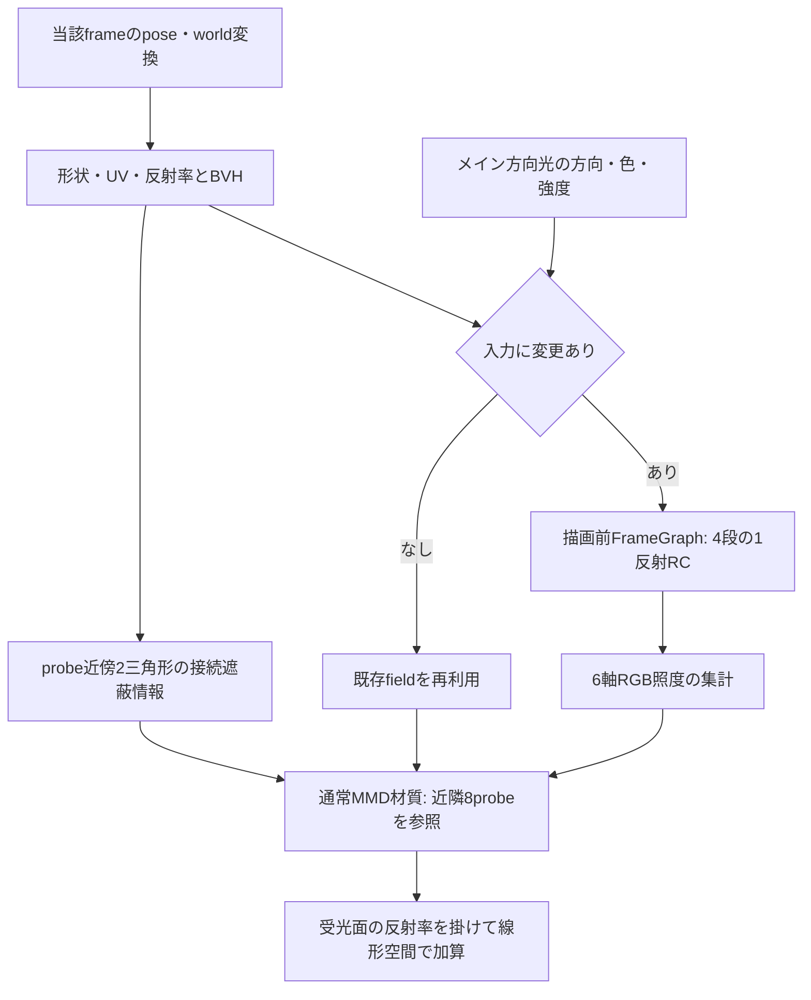

# RC GI: 方向光1反射の通常MMD材質への実装

作成日: 2026-10-30。状態: **実ステージ監査後の演出調整を実装し、所有者実機で効果の変化と快調な速度を確認。右側FrameGraphエフェクト欄へのUI移動も実装・検証済み**。`ee0aa7e`の修正後もGIが見えにくいとの報告を受け、[実ステージ検証](./rc-diffuse-gi-real-stage-audit-2026-10-30.md)で弱い寄与と静止中の費用を確認した。その後、所有者が「推しモデルを映えさせる」目的で強いGIを許可したため、可視probeの正規化と受光側の演出gainを修正した。全モデルでの仕上がりや低性能PCの性能保証には一般化しない。

所有者の「次はGIの方を進めて」という依頼に基づき、[天空遮蔽](./rc-sky-occlusion-implementation-2026-10-29.md)に続く1エフェクトとして実装した。[実装計画](./radiance-cascades-lighting-implementation-plan-2026-10-28.md)のE＋GIに必要なFに相当する。以下は現在の実装説明と過去の検証履歴。実ステージ監査だけの区切り`1d7444e`と、その後の演出調整を区別する。

## 実ステージ監査後の演出調整と実機確認

2026-10-31追記: 3効果のCPU変形/座標変換共有とBVH軽量化に加え、GI近傍guardを形状・範囲変更時だけ更新し、消灯中の形状準備を省いた。強度・演出gain・解像度は維持した。[性能・画像比較と回帰確認](./radiance-cascades-performance-2026-10-31.md)を参照。

[推しモデルが映える強いGIを許容する所有者判断](../insights/decisions/rc-gi-allows-strong-effects-for-favorite-models.md)に基づき、遮られたprobeを照度補間の分母から除き、受光側の反射光を8倍の演出gainで加える。単なる強度不足だけでなく、壁際で有効な反射光が平均に埋もれる問題を修正する。格子・方向数・texture数・dispatch数は増やしていない。対象surfaceのないmeshのpose/snapshot点検も省いた。

補間と可視率を区別する際は、[DDGI一次論文 §5.2](https://jcgt.org/published/0008/02/01/paper-lowres.pdf)の可視性を考慮した重み付け・正規化を参照した。本実装の近傍2三角形guardは同論文の可視性表現とは異なり、同等の精度を保証するものではない。

同じローカルPlaywright条件での前景RGB平均絶対差（8bit、0〜255）は次のとおり。画像は640×360、強度25%・自動範囲。元のPNG自体を目視確認した。

| 対象・カメラ | 監査時 | 今回 |
| --- | ---: | ---: |
| 灯台・近景 | 0.0272 | 0.7411 |
| PowerPlant・近景 | 0.7157 | 5.1958 |
| 灯台・広域 | 0.0281 | 0.1995 |
| PowerPlant・広域 | 0.6018 | 4.2418 |

灯台の塔への緑系の回り込み、PowerPlantの床・壁の暖色寄与が増えた。両対象でOFF復帰画像との差は0。広大な海面を含む灯台の全景は依然として寄与が小さく、全sceneを16³へ収める限界は解決していない。カメラ追従の局所volumeは、範囲端とseek/動画の一致へ影響するため今回導入しない。

キャラクター確認には許可済みlocal referenceのAliciaと、自作の赤壁fixtureを5倍にしたsceneを使う。[任意実行E2E](../test/e2e/rc-diffuse-gi-character-reference.spec.mjs)でGUIから有効・強度・カメラ・骨・方向光を操作し、顔付近を固定撮影する。キャラクターの材質は変更しない。壁の赤→青だけは自作fixture準備helperで変更し、同じOFF顔が完全一致することを確認する。集計はproducerの変形済み三角形から作ったCPU画素maskで背景を除くが、透明な髪などの重なりを完全に分離する材質ID passではない。

- 顔中心領域のOFF/ON平均差: 赤壁25%で11.43、青壁25%で15.63、赤壁100%で25.54階調。
- 赤壁ONから青壁ONへ変更すると、同じ顔領域の平均Rは約3.67低下、Bは約16.26増加。単なる一様な明るさ変更だけではなく、反射元の色が届くことを確認した。赤壁時のRGB増分は白い床など他の反射と肌の明部飽和も含むため、赤増分が最大になるとはしない。
- 袖・胸元の赤/青の色変化を目視確認した。顔・服は100%で白飛びが強く、25%でも明るい肌が飽和する部分がある。最適な見た目として確定せず、所有者の好みで強さを判断する次の比較点とする。
- 強度0・OFFは元のPNGと一致。透明扱いの髪などは現行GIの対象外のまま。

実ステージの静止計測は前回と同じ1280×720、8 warm-up＋24 frame。GPU render平均は灯台1.85→1.86ms、PowerPlant2.66→2.61msで、今回の観測では同程度。CPU source平均は灯台4.04→3.03ms、PowerPlant2.80→2.86ms。灯台の空の7 meshを点検から除けた一方、対象meshの全量比較は残る。両対象ともfield更新0/24、compute dispatch0。独立した統計的な速度保証や低性能PCのFPS保証へは使わない。所有者の街モデルの6fps問題は未再現のまま。

証拠はignoredな`local-references/rc-gi-look-2026-10-30/`に保持する。灯台は`visible-weight-images/`、PowerPlantと輸送回帰は`regression-images/`、設定・PNG/WebMは`character-output-images/`、キャラクターの最終色応答検査は`character-final-images/`。参照asset・PNG・動画はGitへ追加しない。

検証は実ステージ2・キャラ1・輸送3・visibility1・設定/出力1のGPU **8ケース成功**。GIの黒い反射元、反射元への遮蔽、ライト色/消灯、Luminous/天空遮蔽との分離、保存・Undo・キー・backend復帰も確認した。WebMの0/20/40/60frameは対応PNGとの全画面MAE約0.19〜0.26で、ON/OFF遷移を保持。全unit **225ファイル・1,386件成功**、全lint・追加MJS lint成功、通常typecheckは既存547件から追加0、critical gate成功。unitはsandboxの一時ファイル/localhost制約で実行失敗後、ローカル権限の同じ全suiteで成功した。起動コードは変更していないため別のsmokeは追加せず、実Electron/WebGPU E2Eで起動・validationを確認した。キャラE2Eは環境変数`MMD_RC_GI_CHARACTER_REFERENCE=1`を明示した場合だけ実行し、通常条件でskipすることも確認済み。

演出調整の提示後、所有者は見た目について「まあまあ変化ある」、速度について「快調でいい」と報告した。これは所有者が試したシーン・実機での効果と体感負荷の確認として記録し、GI全般の品質了承や、以前の街モデルの6fps問題を同条件で解消した証拠には広げない。続いて、天空遮蔽とGIを実験設定から右側FrameGraphエフェクト欄へ移すよう指定があった（[所有者決定](../insights/decisions/complete-rc-effects-one-at-a-time-for-visual-review.md)）。

今後の比較では、同じカメラで強度25%→50%→100%とOFFを切り替え、光が当たる色付きの壁・床のそばで顔と服の色移り、白飛び、移動時の明暗の跳ねを見る。近傍2三角形近似による遮蔽漏れ、採用probeの切替、広域volumeと透明材質の制約は残る。

## 操作と保存

入口は **右側のEffect → FrameGraph / Post → 追加 → RC GI**。実験設定の本番GI項目は撤去し、右欄の各1枚のsingletonとして追加・OFF・削除を扱う。照明は本描画の材質へ適用するため、一覧での位置は照明の実行順を変えない。複数配置できるLuminous RCのPostFX個体とは区別する。

| 項目 | 初期値 | 編集・保存 |
| --- | --- | --- |
| 有効 | OFF | `enabled`はstepキー。新規・設定のない旧projectは未追加。欄への追加時はON |
| 強度 | 実値0.5、範囲0〜2 | UI 0〜100の25に対応。キーは実値の線形補間 |
| 範囲 | `null`（自動） | world最小XYZと一辺を固定保存できる。キー対象外 |
| 反射 | メイン方向光から1回 | 固定。天空・発光の反射、複数反射は含めない |

固定値は`lighting.rcDiffuseGi`、キーは`keyframes.effectAnimations`の`rcDiffuseGi` singletonへの保存を維持する。欄への追加状態・表示位置はstack側で管理し、追加は既存設定を保持してONにする。個別OFFでは欄・値・キーを保持する。削除は既定OFFへ戻してtrackと欄を除去し、Undoで静的設定・trackのbase/keys/preview・元のstack位置をまとめて復元する。照明値・キーをPostFX個体へ変換しない。

保存には`effects.rcSceneEffectsInStack: true`を追加し、このmarkerがない旧projectだけ、保存済みenabledまたはRC track（全OFFを含む）から欄を補完する。stackのない旧形式でもBloom等の既存効果を保持する。現行形式の削除済み効果は読み込みで復活させず、新設定のない旧projectの見た目も変えない。ClassicとFrame Graph全体OFFでは値・キー・追加状態を保持して実行を休止し、Classicでのキー登録・削除・移動も休止する。通常操作は見出しの有効・キー登録と強度に絞り、普段は自動の計算範囲を折り畳み詳細へ置く。

UI移動後の専用カード・天空設定・GI設定/WebMの3ケースが成功し、独立操作、削除Undo/Redo、保存・移行、Classic往復、PNG/WebMを確認した。GPU validation・page/console errorは0件。全unit226ファイル・1,396件、全lint、critical gateを確認し、通常typecheckは既存547件から追加0件。旧stackなしBloom保持の追加検査も対象2ファイル・67件成功。[共通の操作契約・検証記録](./framegraph-post-stack-current-spec-2026-07-01.md#2026-10-30-追記-rc天空遮蔽giのエフェクト欄への移動)を参照。

自動範囲は、対象材質のsubMeshが参照する変形済み頂点をworld座標へ変換し、最大軸の長さに20%の余白を付けた立方体とする。MMD loaderはmeshと全subMeshの描画用boundsへ共通の余白を付けるため、そのboundsをそのまま使わない。反射率が確実に0の黒い材質は自動範囲から除くが、BVHの遮蔽物には残す。保存値を勝手に固定せず、`null`のままruntimeで保持する。「範囲を再計算」と数値欄のEnterで固定し、「自動範囲」で戻す。mesh・geometry・対象材質・subMeshのindex範囲が変わったときは自動範囲を無効化する。毎フレームの変形・カメラ移動には追従しないため、大きく動くモデルや離れたステージ部品には範囲を調整する。

「適用中」は計算と材質接続の準備状態であり、画素に見える寄与があることまでは保証しない。強度0とメイン方向光の光量0は、それぞれ理由を表示する。対象材質がない状態では、固定volumeが保存されていても適用中にしない。

SSGI / RSM GIの設定は自動変更しない。併用時は反射光が重なるため、最初の比較ではこれらをOFFにしてRC GI単体を確認する。天空遮蔽とは別の強度・有効キーを持つ。

アプリでの初回比較は、通常MMD材質のモデルをFrame Graphで表示し、RC GIを有効にする。強度は25%から始め、色移りを見分けにくければ50〜100%で比較する。ライトが当たる色付きの壁と、その近くの床・暗部を見る。範囲を固定する必要がなければ自動のままでよい。

## 計算の流れと負荷対策

4段のprobe gridは`16³ / 8³ / 4³ / 2³`、方向数は`32 / 128 / 512 / 2048`。距離区間はGI専用とし、最細格子のセル幅を単位に`[0,4] / [4,20] / [20,84] / [84,340]`とする。最初の4セルを最細格子で扱い、近い反射面の寄与が早く粗いcascadeへ移ることを抑える。初版のLuminous由来の距離設定は使わず、既存Luminous側の区間は変更しない。最遠区間は名目上の終端を超えてシーンの遮蔽物まで探索し、画面外・volume外の反射面と遮蔽物も入力へ含める。missは反射光0となり、背景色や発光を代入しない。

rayが当たった面でUV付き反射率、面の幾何法線、方向光との角度、面から光へのBVH遮蔽を評価する。法線はray側へ向け、薄い面は両面の拡散反射として扱う。sourceへ入れる反射RGBは`albedo × lightColor × max(dot(normal, directionToLight), 0)`とし、既存Standard/MMDの方向光の強度規約に合わせる。既存raster影のCSM・bias・影距離は変更しない。

base gridの32方向を`+X / -X / +Y / -Y / +Z / -Z`の6軸へcos重みで正規化し、照度/πとして保存する。材質側は法線の符号で3軸を選び、法線成分の二乗で混ぜる。三線形補間と受光面前方への重み付けを行い、各probeの近傍2三角形で接続の遮蔽を判定する。遮られたprobeは分子・分母から除き、採用できるprobeの重みだけで正規化する。全probeが遮蔽・無効なら0。以前は遮られた重みも分母へ残していたため、採用可能な反射光まで薄まっていた。天空遮蔽の集計規則は変更しない。

材質内でBVH探索は行わず、最大**32 textureLoad＋16個の固定三角形判定**。集計atlasは`96×256 / RGBA16F`で192 KiB、近傍情報は`16×256 / RGBA32F`で64 KiB、計256 KiBの追加画素payloadとなる。4段field・BVH・反射率texture cacheのメモリは別に必要。入力が変わったときだけ4 cascade＋集計＋近傍探索の6 taskを実行し、静止時には再利用する。強度だけの変更はfieldへ焼き込まない。

source revision・範囲・方向光snapshotを更新条件とする。ライトのparent変換、色・強度・有効状態も反映する。同frameのpose確定後・active mesh評価前に実行し、dirty fieldの後だけ`flushFramebuffer()`で提出してから材質を描画する。GPU完了待ちや毎フレームreadbackは追加しない。

source収集では、対象surfaceがないmeshとindexCountが0のsurfaceをpose取得・頂点snapshotより前で除外する。採否は毎回調べるため、材質の透明→不透明、対象外→対象内への変更時には現在の形状で戻る。対象meshの値比較・骨やモーフの点検自体は残る。

## 色と既存効果の分離

反射率は通常MMDのdiffuse色と、`applyAmbientColorToDiffuse`有効時の`scene.ambientColor × material.ambientColor`を合わせた色から作る。diffuse textureは既存の64×64静的cacheを再利用し、UV変換・UV2・wrap・texture levelを反映する。linear化は既存cacheと同じ2.2乗近似。画像は読み込み時に一度readbackし、出力前にも準備を確認する。

Luminousのscene source実装を再利用するが、GIは独立したsourceを所有する。packed color欄には反射率を入れ、Luminous固有の8倍gainを適用しない。発光色・sphere・Toon照明・完成画像・前frameのGIはsourceに戻さない。対応する通常材質presetとLuminous presetのdiffuse反射を入力とし、Luminousの発光自体は既存RC側だけに残す。

受光側はMmdStandardMaterialを使うopaque材質のうち、通常MMD、Light and Shadow、Stage Standard、Accessory Toon、OBJ Untextured、OBJ MTLの既知presetを対象とする。外部shaderや想定外のcustom shaderを持つ材質へ、preset IDだけを理由に適用しない。Luminous presetは反射元だけを許可する。材質pluginは通常の直接光・sphere・specularの合成後、fogとimage processingの前に入り、`linear(元の色) + 8 × strength × linear(受光面の反射率) × field`を加えて表示色へ戻す。8は演出的な強さの調整値で、物理単位や欠けていた定数の修復ではない。sourceへは戻さず、光場が0なら新しい光を作らない。天空遮蔽の係数をGIへ掛けず、通常材質の照明を別の方式で置換しない。GIが0の画素は色空間の往復もせず、元の色を保つ。

保存する強度0〜2とUIの0〜100%は変更しない。**既存projectでGIをONにしていた場合も見た目は強くなる**。弱くしたい場合は強度を下げる。8倍は線形加算する反射光の係数であり、表示画像の明るさが8倍になる意味ではない。強い設定では明部の白飛びや既存の粗いprobe補間・遮蔽漏れも見えやすくなるため、25%から顔・服・壁際を比較する。

初版はsourceに物理的なLambert反射の`/π`を入れていた。一方、Babylon 9.2.0のStandard/MMD直射は`diffuse × getScaledIntensity()`を基にしたdisplay-space合成で、Lambert/Toonの直接寄与に同じ`/π`を入れていない。今回の仕上げではsource側の`/π`を除き、この既存照明の強度規約に合わせた。この除算だけを変え、距離区間と他の条件を固定すれば、clampや丸め前のsource RGBとその線形輸送の値はπ倍になる。画面の8bit差分や、自動範囲・距離区間も変更した今回の比較値がπ倍になるとは限らない。強度の初期値0.5と範囲0〜2は変更しない。

cos正規化した入射fieldは照度/πに相当する平均で、定数の入射RGBを保持する。初版のsourceの`/π`とこの平均は異なる役割なので、変更理由を「πの二重除算バグ」とは扱わない。また、直射のdisplay-space合成やToon段階とGIのlinear加算は異なり、変更後も物理単位の一致や既存Toonの見た目の完全一致は保証しない。粗いcascadeの空間・角度平均では有限の反射面が周囲の黒い方向と混ざり、寄与が弱まり得る。距離区間と自動範囲の修正も含め、光量だけを根拠に近似精度が改善したとは判断しない。

## 主な実装箇所

| 役割 | 実装 |
| --- | --- |
| 初期値・保存値正規化 | [rc-diffuse-gi-settings.ts](../src/render/rc-diffuse-gi-settings.ts) |
| 独立UI・Action/Undo | [設定panel](../src/ui/rc-diffuse-gi-settings-panel.ts)、[Command差分](../src/actions/rc-diffuse-gi-command.ts) |
| dirty判定・描画前更新・capture準備・資源寿命 | [rc-diffuse-gi-controller.ts](../src/render/rc-diffuse-gi-controller.ts) |
| light snapshot・反射率source | [ライト](../src/render/rc-diffuse-gi-light.ts)、[反射率](../src/render/rc-diffuse-gi-source.ts) |
| 自動範囲・対応preset・GI専用距離区間 | [範囲](../src/render/rc-diffuse-gi-volume.ts)、[対応材質](../src/render/rc-diffuse-gi-material-eligibility.ts)、[距離区間](../src/render/rc-diffuse-gi-intervals.ts) |
| 専用FrameGraph・RC輸送・照度集計 | [field](../src/render/rc-diffuse-gi-field.ts)、[cascade shader](../src/render/rc-diffuse-gi-shaders.ts)、[6軸集計](../src/render/rc-diffuse-gi-irradiance.ts) |
| 材質参照・合成・中立fallback | [query](../src/render/mmd-radiance-gi-query-wgsl.ts)、[plugin](../src/render/mmd-radiance-diffuse-gi-plugin.ts) |

FrameGraphのtask順序・ready・破棄は[公式のtask lifecycle](https://doc.babylonjs.com/features/featuresDeepDive/frameGraph/frameGraphClassFramework/frameGraphWritingTasks/)とローカルBabylon 9.2.0の`FrameGraphComputeShaderTask`を照合した。材質hookと表示色→linearの境界は同版`ShadersWGSL/default.fragment.js`、MMDのdiffuse式は導入済みbabylon-mmdの`Loader/ShadersWGSL/mmdStandard.js`で確認した。pluginの併用・OFF・破棄は実物のMaterialPluginManagerを使うunitでも検証した。

## 対象範囲と制約

- 単一の通常カメラが対象。scene custom render target・複数/rig camera・PrePassでは中立化する。RSM GIとの併用はそのrender target条件にも左右される。
- PBR・外部WGSL・特殊preset・透明/alpha-test・lightmap・diffuse Fresnel等は受光対象外。背景やhelperは対象にしない。
- sourceの非既定texture色モーフ・vertex colorは反射率0として遮蔽だけ残す。動的texture、UVモーフ、normal mapやsmooth normalによる反射の再現は対象外。
- coarse probeと6軸近似、2候補だけの接続遮蔽には誤差があり、薄壁の漏れ・屋根端の過暗化を一般に解消するものではない。volume外は寄与0で、境界fadeは未実装。
- 天空・発光の追加反射、多重反射、鏡面GIは未実装。単一の方向光だけを使い、追加ライトやライトのmesh別include/excludeは評価しない。
- 天空遮蔽・LuminousとのGPU source/field共有は未実装。併用するとCPU変形・BVH更新も各sourceで行う。小さいfixtureの費用を密なPMXや低性能PCの全体FPSへ換算しない。
- 今回のGI実描画で動かした形状はbone付き遮光板。morph/physicsは既存の共通pose入力を利用するが、GIを有効にした個別の実描画比較は未実施。

## 仕上げ修正と再検証（2026-10-30）

所有者の目視NGを受け、対応presetの不足、描画用boundsの余白と無関係な黒い部品によるprobe密度低下、GI専用の近距離区間、既存照明との強度規約、寄与0の理由表示を修正した。画素ごとのBVH探索は追加せず、既定強度・格子数・6 task・材質の固定参照数は維持する。全対象を隠した間に移動し、再表示した場合も自動範囲を取り直す。

配布可能な36三角形fixtureを使い、[visibility E2E](../test/e2e/rc-diffuse-gi-visibility.spec.mjs)で既定強度0.5の画像を比較した。直接光を受けない床は、Light and Shadowの影色とToon残留だけをGUIで0にして作る。CSMやshadow generatorの設定は変更しない。受光面7,014画素のON−OFF平均は次のとおり。自動→固定→自動の復元画像差は0、GPU validation・page error・console errorも0件。

| 受光条件 | 範囲 | RGB平均増分 |
| --- | --- | --- |
| 通常MMD・通常照明 | 自動、一辺7.2 | `[4.45195, 0, 0]` |
| 通常MMD・通常照明 | 固定、一辺16 | `[3.71243, 0, 0]` |
| Light and Shadow・直接光なし | 自動、一辺7.2 | `[43.45694, 1, 1]` |
| Light and Shadow・直接光なし | 固定、一辺16 | `[39.28315, 1.04691, 1.03821]` |
| Stage Standard・通常照明 | 自動、一辺7.2 | `[5.23810, 0, 0]` |

通常MMD・固定16の初版は`[1,0,0]`であり、この同条件で赤い反射が約3.7倍の階調差になった。自動範囲は初版の57.84から7.2へ縮小し、同じ16³格子を受光面へ集中できた。黒い遮蔽板とloaderの余白は範囲から除かれるが、遮蔽判定は維持する。暗所OFFの床は`[0,0,0]`で、今回はGIだけの反射が見えることを確認した。Stageのsource/receiverはGUIから適用した。Accessory/OBJはPMXのメニューに存在しないため、この実描画テストには含めず、対応判定のunitとshader経路の確認に限定する。

強度0・主光量0の理由表示と復帰も同じGUIテストで確認した。完全な停止を検出する画素readback監視は追加していないため、「適用中」は有意な光量や全画素の正しさを保証する表示ではない。

性能5条件も成功した。測定方法・adapter・fixture・固定volume・warm-up/40frame集計は下の初版計測と同じ。全条件40/40frameでtimestampを取得し、各GPU validationとpage errorは0件。

| 条件 | GPU描画pass合計（ms） | GPU compute合計（ms） | CPU controller（ms） | field更新 / 40frame |
| --- | ---: | ---: | ---: | ---: |
| 640×360・静止OFF | 0.185139 | 0 | 0.005625 | 0 |
| 640×360・静止ON | 0.303514 | 0 | 0.225250 | 0 |
| 1280×720・静止ON | 0.332698 | 0 | 0.207125 | 0 |
| 640×360・変形ON | 0.303770 | 0.162048 | 0.505500 | 40 |
| 1280×720・変形ON | 0.336384 | 0.166502 | 0.496625 | 40 |

近距離区間を延ばした後のcomputeは初版の約0.14msから約0.16〜0.17msとなった。格子・サンプル数・6 dispatch/frame・材質参照数は増やしていないが、探索距離を変えるためproducerの実費用が完全に同じとはしない。静止時のfield再利用は維持する。この小さいfixtureの数値は、低性能PC・密な実モデルの性能保証ではない。その後の所有者確認はNGであり、上記の実ステージ検証を最新の状態とする。

全unitは**225ファイル・1,383件成功**、全lintと`typecheck:critical`も成功。通常typecheckは既知547件で、初版baselineから行・列を正規化して比較した追加は0件。範囲のpadding・morph/world・黒面と材質変更、非表示/再表示、未使用材質の誤検出、preset判定、距離区間、理由表示をunitで確認した。対象GPU E2Eは性能5・設定1・visibility1・輸送3の10件が成功し、赤/黒/texture・光への遮蔽・Luminous/天空遮蔽との分離・保存/Undo/キー/backend・PNGの回帰を確認した。

最終の非表示/再表示修正後、設定E2Eを`MMD_RC_GI_SETTINGS_WEBM=1`で、visibility E2Eと併せて再実行し、2件成功した。自動描画を停止したcaptureと隔離WebM rendererでも、enabled/strengthキーのOFF/ON差、PNGとの一致条件、GPU validationを確認した（`webm-final.txt` / `webm-final-images/`）。

途中の暗所テストでは、ライトYのGUI操作時に他軸の値も更新され、意図した`[-1,0,0]`ではなく`[+0.39,0,+0.65]`になっていた。これは反射元の受光側を照らさない条件であり、初版の微小な赤増分や新区間での0を、意図した暗所照明の改善・回帰の比較には使えない。3軸すべてをGUIで明示設定し、保存されたライト値をassertする条件へ直して再検証した。記録先は`local-references/rc-diffuse-gi-finish-2026-10-30/`、`e2e-final.txt` / `final-images/`、`performance/*.json`、`unit-final.txt`、`lint-final.txt`、`typecheck-final.txt`、`critical-final.txt`。

## 初版の検証履歴（89f5659、仕上げ修正前）

配布可能な[専用fixture](../test/fixtures/rc-diffuse-gi-stage/README.md)とGUI E2Eを使用し、ユーザー所有モデルは検証に使っていない。2026-10-30、全unitは**221ファイル・1,349件成功**、全lintと`typecheck:critical`も成功した。最終の反射率・ライト・pluginのunit 3ファイル12件も成功。通常typecheckは既知547件で失敗するが、天空遮蔽の最終baselineと行・列を正規化して比較した追加は0件。記録は`local-references/rc-diffuse-gi-2026-10-30/`の`unit-first.txt`、`unit-final-focused.txt`、`lint-final.txt`、`typecheck-final.txt`。

GUIで赤・黒・texture付き赤の3条件を実行し、3件が成功した（`isolated-e2e.txt`、`isolated-images/`配下のreportとPNG）。8bit RGBのON−OFF差を、独立に投影した受光面の領域で比較している。

| 比較 | 確認結果 |
| --- | --- |
| 赤 / texture付き赤 | 既定強度0.5で受光面7,014画素の平均増分は両方とも`[1, 0, 0]`。diffuse色が白のtexture付き条件でも赤い反射を確認 |
| 黒い反射面 | 同じ受光面の平均増分は`[0, 0, 0]` |
| 画面外source | 実際のsource頂点が画面左端の外にある構図で、受光面158,385画素の平均増分`[1, 0, 0]`を確認 |
| 面から光への遮蔽 / 光方向反転 / 緑の光 | 赤い反射の増分が0になることを確認 |
| 天空遮蔽併用 / Luminous presetの反射面 | 赤い反射の増分を維持。Luminous presetへ変えた前後の赤増分差は0 |
| 発光と直接光の分離 | 反射面をLuminous presetにしたまま直接光を0にすると、GIのON/OFF画像差は0 |
| 強度0 / OFF復帰 | それぞれ元のOFF画像との全画面MAEは0 |

最後に床だけLight and Shadowへ変更し、横向き光でも赤い反射の増分1.52324を確認した（`transport-final.txt`、`transport-final-images/`）。このfixtureの通常材質はToonなし、Light and Shadowのfallback Toonも白のため、床の幾何学的な直接光cosが0でもOFF時の表示は平均`[122, 122, 120]`を保った。この追加確認を「暗い床をGIだけで照らした検証」とは扱わず、異なる対応presetと光方向での反応の確認に限定する。

上記3条件のGPU validation、page error、console errorは0件。赤の増分は1階調と小さく、これは入力変更への反応と寄与分離の確認であり、反射光量の物理精度や実モデルのルック了承を示すものではない。

[設定E2E](../test/e2e/rc-diffuse-gi-settings.spec.mjs)ではGUIから初期値、固定/自動範囲、Enter確定、再計算、Undo/Redo、enabled/strengthキー、previewのUndo、project保存/読込、Classic/Frame Graph往復を確認した。強度0→1のPNGは受光面の赤が平均1.74893増加し、保存・backend往復後と手動描画の最初のOFF/ON PNGは元画像に全画面・受光面とも一致した。自動描画を止めたまま出力したWebMの0/20/40/60frameもPNGとの全画面MAE 0.188〜0.239で、受光面のON/OFFの赤増分を保持した。GPU validation、page error、console errorは0件（`settings-verified.txt`、`settings-verified-images/`）。

追加の回帰3件ではLuminous RCの既存描画・PNG、RC天空遮蔽の設定・保存・backend・WebM、GI＋天空遮蔽＋Luminous RCの同時ONを確認した。同時ON時は12 emitterで描画し、直接光を0にしてもLuminous RCの寄与が独立して残った（`regression.txt`、`regression-images/`）。`smoke:launch`もWebGPU/Bullet MPRで起動・安定待ちまで成功した（`smoke.txt`）。

検証中には設定E2Eの全画面平均が小さいGI寄与を薄めたため受光面のROI判定へ変更し、backend切替のrenderer再起動待ちを修正した。Vite optimizer cacheの競合による504もあったため、E2E helperへ任意の`MMD_E2E_VITE_CACHE_DIR`を追加して実行中editorとcacheを分離した。上記の成功結果は修正・再検証後の記録で、途中の失敗を成功件数に含めない。

## 初版の性能計測履歴（2026-10-30、仕上げ修正前）

[性能E2E](../test/e2e/rc-diffuse-gi-performance.spec.mjs)の5条件が成功した。36三角形のオリジナルfixture、同じcameraと固定volume（最小`[-8, -2, -8]`、一辺16）を使い、条件ごとに独立したElectron processで測定した。GPU adapter情報は`vendor=nvidia`、`architecture=ampere`で、device名・descriptionは空欄。診断用deviceでtimestamp-queryを有効にし、**12フレームのwarm-up後の40フレームの算術平均**を記録する。

| 条件 | GPU描画pass合計（ms） | GPU compute合計（ms） | field更新 / 40フレーム |
| --- | ---: | ---: | ---: |
| 640×360・静止OFF | 0.173184 | 0 | 0 |
| 640×360・静止ON | 0.306227 | 0 | 0 |
| 1280×720・静止ON | 0.313626 | 0 | 0 |
| 640×360・変形ON | 0.298419 | 0.141696 | 40 |
| 1280×720・変形ON | 0.324198 | 0.143616 | 40 |

変形ONは光への遮蔽板をboneキーで動かした条件で、40フレーム中40回のfield更新・240回のcompute dispatch（6 task/frame）を確認した。静止ONはsourceを点検するがfieldのcomputeは再実行しない。初期構築と反射率textureの初回readbackはwarm-up前の費用で、この表には含まない。1280×720のOFFは未計測。

| 条件 | CPU controller（ms） | CPU source更新（ms） | CPU field実行提出（ms） |
| --- | ---: | ---: | ---: |
| 640×360・静止OFF | 0.005000 | 0 | 0 |
| 640×360・静止ON | 0.160125 | 0.064375 | 0 |
| 1280×720・静止ON | 0.221125 | 0.098625 | 0 |
| 640×360・変形ON | 0.500500 | 0.179625 | 0.207000 |
| 1280×720・変形ON | 0.453125 | 0.168750 | 0.179500 |

CPU値は`performance.now()`による同じ40フレームの平均で、controller内にsource更新とfield実行提出を含むため各列を足さない。field実行提出はGPU完了時間ではなく、CPUから計算を設定・提出する区間である。GPU描画値は全描画passの合計でGI材質だけの時間ではなく、GPU timestampにはqueueの隙間・CPU処理・画面表示待ちは含まない。別途12フレームの完了待ち計測もJSONへ残すが、リアルタイム側の値やFPSへ混ぜない。

5条件とも40/40フレームのGPU timestampが揃い、計測中・終了処理後・参照PNG出力後のGPU validationは0件、page errorも0件だった。根拠は同directoryの`performance/{解像度}-{static|moving}-{on|off}.json`。この結果は小さいfixtureの局所費用であり、密なPMX、physics、他効果併用、低〜中性能PCの持続FPSや全体性能を保証しない。
